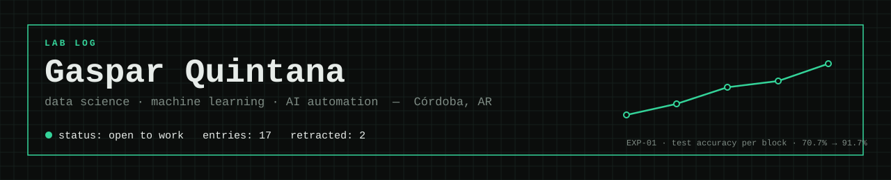
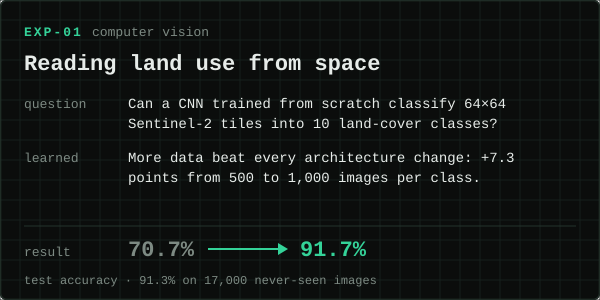
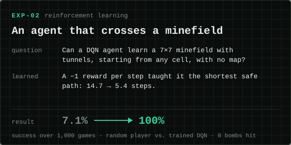
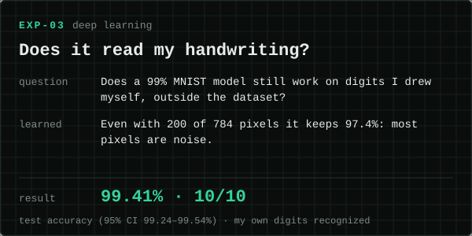
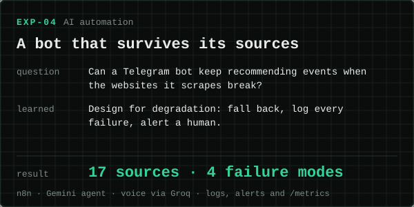
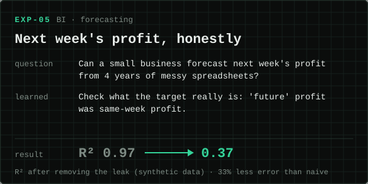
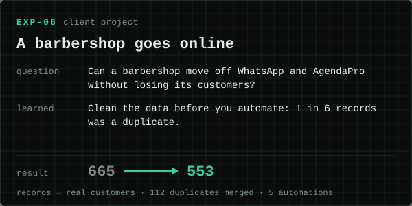

I'm a data scientist from Córdoba, Argentina. This profile is my lab log: every project is written up as an experiment, with the question, the result and what I learned. When a result doesn't hold up, it goes in the log too.

**Contact:** [gasparquintana125@gmail.com](mailto:gasparquintana125@gmail.com)

## Experiments

<p>
  <a href="https://github.com/GasparQC/land-cover-cnn-eurosat"></a>
  <a href="https://github.com/GasparQC/rl-minesweeper-agent"></a>
</p>
<p>
  <a href="https://github.com/GasparQC/mnist-handwritten-digits"></a>
  <a href="https://github.com/GasparQC/agenda-cultural-cordoba-n8n"></a>
</p>
<p>
  <a href="https://github.com/GasparQC/deloto-data-platform"></a>
  <a href="https://github.com/GasparQC/killer-kutz-booking"></a>
</p>

## Retracted

Two of my own results didn't survive a second look. I keep them here on purpose.

| Entry | Reported | After the fix | What was wrong |
|---|---|---|---|
| [Titanic survival](https://github.com/GasparQC/titanic-random-forest) | 98.9% accuracy | **81.6%** | Family and ticket survival rates were computed with the test passengers' outcomes |
| [Deloto weekly profit](https://github.com/GasparQC/deloto-data-platform) | R² 0.885 | **0.37** (synthetic data) | The "future" profit target was same-week profit, and an unshifted rolling mean included it |

## In progress

**EXP-07 · Unbiased valuation ranges (thesis).** Investors type 5-year assumptions (sales growth, margins, cash flow) into a spreadsheet by hand, and the verdict depends almost entirely on them. I'm building a model that gives a calibrated reference range for each assumption, based on what thousands of comparable companies actually achieved. It runs on point-in-time SEC filings with quantile models and conformal calibration, is validated walk-forward, and is compared against random-walk, mean-reversion and base-rate baselines.

## Also in the log

- [Breast cancer diagnosis](https://github.com/GasparQC/breast-cancer-classification): SVM at 97.6% cross-validated, 94.7% on held-out data; DNN and PCA.
- [Heart disease](https://github.com/GasparQC/heart-disease-ensemble): a regularized logistic regression (83.8%) beat every ensemble.
- [Natural-language peripherals search](https://github.com/GasparQC/peripherals-search-engine): FastAPI with TF-IDF and rule-based ranking (team project).
- [Statistical inference](https://github.com/GasparQC/statistical-inference): chi-square, ANOVA and mutual information, checking assumptions first.
- [Neural network foundations](https://github.com/GasparQC/ml-foundations): a perceptron and gradient descent in NumPy, then a tuned DNN.
- [Computer vision fundamentals](https://github.com/GasparQC/computer-vision-fundamentals): OpenCV transforms, filters and a hand-built Sobel.
- [SQL Server sales forecasting](https://github.com/GasparQC/sql-sales-forecasting) · [Power BI dashboards](https://github.com/GasparQC/powerbi-dashboards) · [Real estate EDA](https://github.com/GasparQC/real-estate-eda-buenos-aires) · [Blood pressure EDA](https://github.com/GasparQC/blood-pressure-eda)

## Instruments

```text
modeling     Python · scikit-learn · TensorFlow/Keras · PyTorch · LightGBM · Stable-Baselines3
data         pandas · NumPy · SQL Server · PostgreSQL · Power BI · Excel
automation   n8n · Claude Code · FastAPI · Telegram bots · LLM agents
tooling      Git · Docker · Google Colab · AWS (Cloud Practitioner)
```

Before data I sold cars and prefab houses and worked at a newspaper, so I build tools with the people who will use them in mind. At work I cut weekly sales reporting from 4 hours to 30 minutes with n8n and Power BI, and replaced manual inventory tracking for 500+ items with a Telegram bot.

## Activity

Each experiment is committed on the date it was actually run.

<picture>
  <source media="(prefers-color-scheme: dark)" srcset="https://raw.githubusercontent.com/GasparQC/GasparQC/output/github-snake-dark.svg" />
  
</picture>

<details>
<summary><b>En español</b></summary>

Soy científico de datos, de Córdoba. Este perfil es mi bitácora de laboratorio: cada proyecto está contado como un experimento, con la pregunta, el resultado y lo que aprendí. Cuando un resultado no se sostiene, también queda registrado: corregí dos de los míos (Titanic y Deloto) al encontrar fugas de datos.

Tengo aprobadas las 24 materias de la Tecnicatura en IA y Ciencia de Datos (Universidad Siglo 21) y estoy haciendo mi tesis sobre rangos de valoración de empresas con ML. Busco un puesto de analista o científico de datos, full time.

📫 gasparquintana125@gmail.com

</details>
